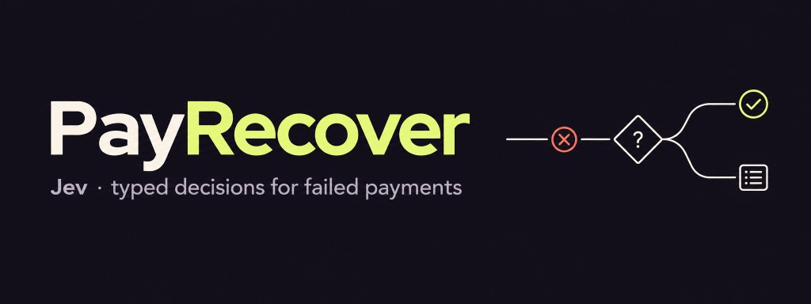
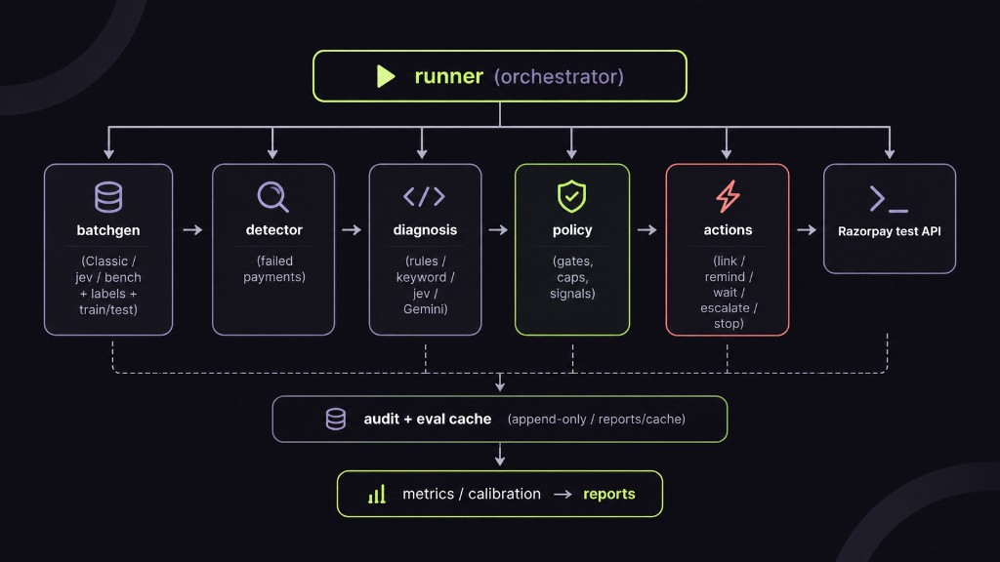

[](LICENSE)
[](pyproject.toml)
[](https://razorpay.com/docs/payments/payments/test-card-details/)

Detects failed Razorpay one-time payments, diagnoses the cause with a
**rules-first → Jev typed decision → Gemini fallback** cascade, and recovers
revenue through bounded actions — payment links, reminders, escalation — with an
audit trail and measured batch recovery.

Built on top of the frozen v1 slice from
[Nish344/payrecover-agent](https://github.com/Nish344/payrecover-agent).
This tree adds [Jev](https://docs.typesafe.ai/introduction) (TypeSafe System One)
for calibrated, typed diagnosis — and a fair eval so the claim is defensible.

See [`plan.md`](plan.md) for the full plan (Parts I–III) and
[`docs/decisions.md`](docs/decisions.md) for the decision log.

## What this claims (and what it doesn't)

**Claim:** On the held-out synthetic bench (`--profile bench`, `--split test`, n=166),
Jev is better calibrated than a cheap generative model, and its accuracy point
estimate is higher. Numbers from `reports/sample/eval.md` (Jev `typesafe/jev-1.14`,
comparison arm `gemini-3.5-flash-lite`):

| arm | accuracy | 95% Wilson CI | ECE |
|---|---|---|---|
| rules | 43.37% | [36.07%, 50.98%] | 0.151 |
| keyword | 74.10% | [66.94%, 80.16%] | 0.179 |
| llm (gemini-3.5-flash-lite) | 80.72% | [74.05%, 86.00%] | 0.189 |
| jev | 87.95% | [82.12%, 92.06%] | 0.059 |

Jev cost on that split was $0.0055 ($0.033 / 1k cases). Self-consistency
(`reports/sample/consistency.md`): 20 cases × 5 runs, answer-change rate 0.0,
mean confidence std 0.0076.

The calibration gap is the result that matches the v1 bug. In the 0.9–1.0
confidence bin, Gemini is 79.5% accurate at 0.98 mean confidence (2
high-confidence errors on `ambiguous`). Jev in the same bin is 98.5% accurate
at 0.98 mean confidence (0 high-confidence errors on `ambiguous`).

**Not claimed:**

- A statistically significant accuracy win. The Jev and Gemini Wilson intervals
  overlap, so the 88% vs 81% gap is a point estimate.
- 100% on the old 8-sentence demo. That number was circular.
- That Jev reads conflicting fields better. On the `conflicting` family
  (structured `error_reason` disagrees with the description; label = description),
  Jev is 0/11 because it trusts the structured reason. Keyword and Gemini are
  7/11. That is the trusted-field rule, stated here so it is not a surprise in
  the by-family table.
- One Gemini call in this run returned HTTP 503 and was scored as the rules
  fallback (path counts: `llm` 165, `rules` 1).

## Setup

```bash
python3 -m venv .venv
source .venv/bin/activate
pip install -e ".[dev]"
cp .env.example .env
# Fill:
#   RAZORPAY_KEY_ID / RAZORPAY_KEY_SECRET   (test mode)
#   OPENROUTER_API_KEY                     (Jev)
#   GEMINI_API_KEY                         (fair A/B + calibration)
```

Offline smoke (no model keys):

```bash
payrecover dataset-info
payrecover seed --seed 100 --profile bench --force
payrecover eval --arms rules,keyword --split test --output reports/eval-offline.md
```

Full fair ladder (after keys are in `.env`):

```bash
payrecover seed --seed 100 --profile bench --force
payrecover eval --arms rules,keyword,jev,gemini --split test \
  --train-sweep --output reports/eval.md
# optional (spends credits):
payrecover consistency --arm jev --split test --runs 5 --limit 20 \
  --output reports/consistency.md
```

## Commands

| Command | What it does |
|---|---|
| `payrecover ping` | Authenticated test-mode Razorpay read |
| `payrecover detect [--since 1d] [--cohort …] [--export-fixtures]` | Read-only ingest of failed payments |
| `payrecover realgen` | Create test-mode Payment Links for the real cohort |
| `payrecover seed --profile classic\|jev\|bench` | Synthetic cases (`bench` = held-out corpus; `--keep-real` default) |
| `payrecover dataset-info` | Corpus size / family / split summary |
| `payrecover run [--diagnosis auto\|rules\|keyword\|jev\|gemini]` | Recover batch (dry-run default) |
| `payrecover eval --arms … --split test\|real` | Fair A/B (+ `--mask-reason` for real) |
| `payrecover consistency --arm jev` | Self-consistency (N runs, no cache) |
| `payrecover report` | Recovery metrics |
| `payrecover audit <case-id>` | Append-only trail |

## Architecture



### Baseline ladder (eval arms)

1. `rules` — exact `error_reason` match only  
2. `keyword` — deterministic regex over description (fair cheap baseline)  
3. `gemini` — same taxonomy, self-reported confidence  
4. `jev` — typed Choice + Noul probabilities  

Tune thresholds on **`--split train`** (see `--train-sweep`); publish **`--split test`**.

### Invariants

1. Every action passes through `policy.py`. Only `actions.py` writes to Razorpay.
2. Every decision is audited (Jev logs full probability + Noul signals).
3. Caps: max 2 links / 3 reminders; amount = original; opt-out permanent; escalate on
   `ambiguous`, confidence &lt; 0.6, amount &gt; ₹5,000, or `requests_dispute`.
4. Models cannot mint a transient wait *cause* from untrusted text without Noul
   corroboration (`is_transient` strong + `customer_fault` low).
5. Response cache under `reports/cache/` makes eval reruns free and reproducible.

## Real Razorpay test-mode cohort

Reproduce the API-shape check in ~15 minutes (test keys only):

```bash
payrecover realgen --scenarios all --repeat 2 --cohort real-v1 --amount-max 100
# Pay each link on Checkout: listed test card → mock bank page → Failure
payrecover detect --since 1d --export-fixtures
payrecover eval --split real --arms rules,keyword,jev,gemini --output reports/eval_real.md
```

**What it validates:** real `pay_*` objects through `detector → diagnosis → policy`,
Razorpay `error_reason` vocabulary gaps (e.g. singular `insufficient_fund`, generic
`payment_failed`), and whether arms abstain on out-of-taxonomy reasons.

**What it is not:** a large labeled benchmark. Test-mode descriptions are one fixed
string per reason (zero paraphrase diversity), n will be ~30–50, CIs will be wide, and
for card scenarios the label is often determined by which test card / notes tag was
used — so rules accuracy on tagged reasons can be tautological. Say all of this in the
report. Real-cohort numbers never go in the synthetic headline table; `derived` labels
never count toward accuracy.

## Limitations

- **Synthetic primary bench.** The headline eval uses diverse paraphrases plus
  hard/adversarial families. It is not production Razorpay traffic. The real
  test-mode cohort above is a secondary API-shape check, not a benchmark.
- **Single decision-model vendor.** Jev runs through OpenRouter. Results are
  vendor- and version-specific (`typesafe/jev-1.14` in the sample report).
- **Finite n.** Always publish Wilson 95% CIs with point estimates. Do not lead
  with bare percentages.
- **Train before test.** Freeze confidence/policy thresholds on `--split train`
  (see `--train-sweep`). Only then cite `--split test`. Do not retune from test.
- **Do not fit the small real cohort.** Keep policy defaults frozen
  (`MIN_CONFIDENCE=0.6`, Noul/dispute/transient signal threshold `0.70`). Do not
  retune those from real-cohort n (~30–50).

## Tech stack

Python 3.11+, `razorpay` SDK (test mode), Jev via OpenRouter System One (`httpx`),
optional Gemini, Pydantic v2, SQLite, Typer, pytest, ruff.
